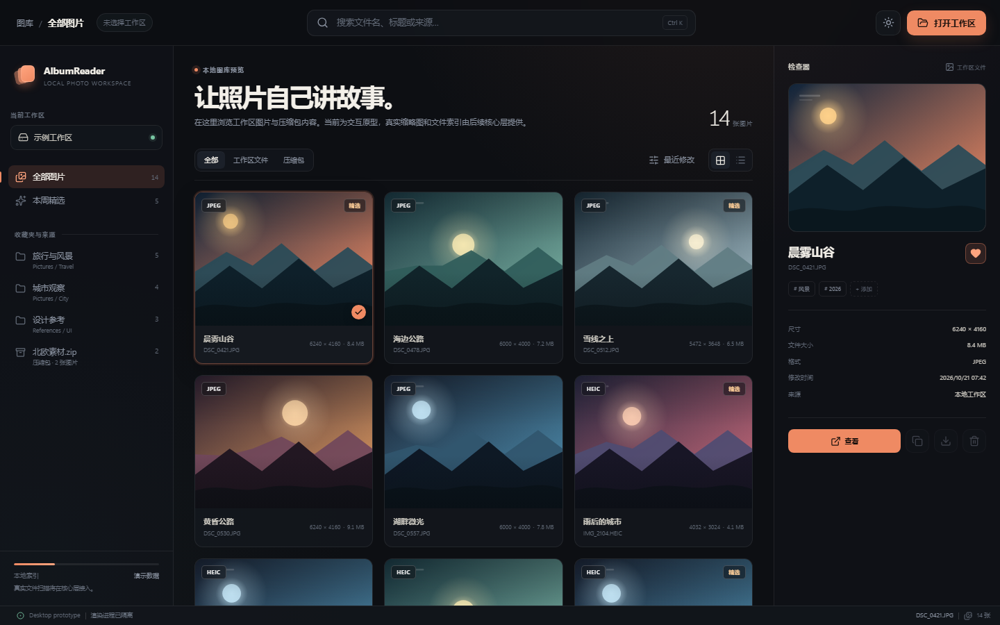

# 前端设计入门与资源

这篇文档解决两个问题：

1. 不会网页设计，如何自己决定「什么元素放在哪里」。
2. 想自己设计布局、动画、交互，应该看哪些官方教程，是否要用现成 UI / 设计框架。


---

## 一、先看 AlbumReader 为什么这样布局

当前界面采用桌面工具最稳定的三栏结构：



```text
┌──────────────────────────────────────────────────────────────┐
│ 顶栏：位置 / 搜索 / 全局操作                    66 px        │
├──────────┬───────────────────────────────┬───────────────────┤
│ 导航栏   │ 主内容区                       │ 检查器            │
│ 250 px   │ 自适应                         │ 326 px            │
│          │ 图片网格 / 列表                │ 预览 + 元数据      │
├──────────┴───────────────────────────────┴───────────────────┤
│ 状态栏                                                       │
└──────────────────────────────────────────────────────────────┘
```

这不是随便摆的，而是对应三个问题：

| 区域 | 回答的问题 | 放什么 |
| --- | --- | --- |
| 左侧导航 | 我去哪里？ | 工作区、收藏夹、文件夹、压缩包 |
| 中间内容 | 我现在看什么？ | 图片网格、筛选、排序 |
| 右侧检查器 | 这一张是什么？ | 大预览、尺寸、格式、来源、操作 |
| 顶部 | 全局能做什么？ | 搜索、打开工作区、主题切换 |
| 底部 | 系统现在什么状态？ | 图片数量、当前文件、索引状态 |

大原则：**一个区域只承担一个主要问题。** 不要在导航栏塞图片详情，也不要在内容区塞设置。


---

## 二、30 分钟完成一次界面设计

不需要先成为设计师。用 Figma 免费版或 Excalidraw 都可以。

### 第 1 步：列任务，不列控件

先写用户在这页要完成的 3 件事：

1. 找到某个工作区或压缩包。
2. 快速浏览缩略图并选中一张。
3. 查看这张图的尺寸、来源，或打开大图。

### 第 2 步：列出必须出现的内容块

例如：

- 工作区入口
- 搜索框
- 来源筛选
- 图片缩略图
- 图片名称 / 格式 / 尺寸
- 大图预览
- 元数据
- 打开大图按钮

### 第 3 步：用主任务优先的方式摆放

顺序建议：

1. 先放最大、最常用的区域：图片内容区。
2. 再放辅助导航：左侧。
3. 再放次要详情：右侧。
4. 最后放全局搜索、按钮、状态。

### 第 4 步：画三个状态，而不是一张静态图

至少画：

- **空状态**：尚未打开工作区。
- **已选中**：选中一张图片，右侧检查器有内容。
- **大图模式**：图片铺满视野，其他 UI 退后。

这样能提前发现：按钮该不该出现、信息该不该折叠、动画是否必要。

### 第 5 步：用 8 px 网格和有限层级

当前工程使用的规则：

- 间距：`8 / 12 / 16 / 24 / 32 px`
- 圆角：`8 / 12 / 18 px`
- 字号层级：`9 / 11 / 13 / 17 / 32 px`，主标题再单独放大
- 动画：`160–500 ms`
- 一屏只保留一个高饱和强调色（当前是暖橙色）

Figma 教程入口：

- Figma Basics（官方）：https://help.figma.com/hc/en-us/categories/360002051613-Figma-basics
- Figma Learn（官方资源库）：https://www.figma.com/resource-library/
- Figma Community 搜索关键词：`desktop app UI kit`、`photo gallery UI kit`、`wireframe kit`

免费线框工具：

- Excalidraw：https://excalidraw.com/
- Penpot：https://penpot.app/

> 设计工具负责决定位置，代码负责实现位置。不要一开始就在 React 里一边写 CSS 一边想布局。

---

## 三、最省时间的官方学习路径

不要从学完 HTML/CSS/JS 开始。按需要学：

1. **CSS 布局**
   - MDN CSS Grid：https://developer.mozilla.org/en-US/docs/Web/CSS/CSS_grid_layout
   - MDN Flexbox：https://developer.mozilla.org/en-US/docs/Web/CSS/CSS_flexible_box_layout
   - web.dev Learn CSS：https://web.dev/learn/css
2. **React 基础**
   - 官方 Learn：https://react.dev/learn
   - 重点先学：组件、props、state、事件、条件渲染、列表渲染、`useEffect` 的边界。
3. **Electron 架构**
   - 快速开始：https://www.electronjs.org/docs/latest/tutorial/quick-start
   - 进程模型：https://www.electronjs.org/docs/latest/tutorial/process-model
   - 安全清单：https://www.electronjs.org/docs/latest/tutorial/security
   - Electron Forge：https://www.electronforge.io/
4. **动画**
   - CSS transition / animation 先满足 90% 需求。
   - 需要复杂编排时再看 Motion：https://motion.dev/docs
5. **桌面交互规范**
   - Microsoft Fluent 2：https://fluent2.microsoft.design/
   - Apple Human Interface Guidelines：https://developer.apple.com/design/human-interface-guidelines/
   - Material Design 3：https://m3.material.io/

建议顺序：**先抄布局规则，再补 CSS，再补动画。** 不要先装一堆库。


---

## 四、所谓快速平面设计框架怎么选

这里要区分三类东西：

| 类型 | 例子 | 能直接决定元素位置吗 | 建议 |
| --- | --- | --- | --- |
| 线框 / 设计模板 | Figma Community kits、Excalidraw | 可以，定布局最快 | 设计阶段用 |
| 官方设计系统 | Fluent 2、Apple HIG、Material 3 | 能给出成熟模式和尺寸规则 | 查规则用，不要整套照搬 |
| 代码 UI 框架 | shadcn/ui、Tailwind CSS、Bootstrap | 给组件和样式，不替你决定信息架构 | 按需使用 |

### 推荐方案

- **布局**：Figma 线框 + 本文的三栏模式。
- **视觉规则**：参考 Fluent 2；图片查看器需要内容优先，所以界面比常规后台更安静。
- **代码组件**：当前先保留自定义 CSS + design tokens。以后需要下拉菜单、Dialog、Toast、Tabs 时，再评估 [shadcn/ui](https://ui.shadcn.com/docs)。它提供可复制、可修改的无障碍 React 组件，不会锁死整套视觉。
- **工具类 CSS**：如果以后觉得手写 CSS 太慢，可评估 [Tailwind CSS](https://tailwindcss.com/docs)，但它解决的问题是写样式更快，不是布局该长什么样。
- **不建议现在上 Bootstrap**：能快速出通用网页，但本项目是图片查看器，通用后台感会很强，后期反而要花时间覆盖样式。
- **动画**：先用 CSS `transition` / `@keyframes`。等出现跨页面转场、共享元素、手势拖拽，再引入 Motion。

### 一条实用判断

> 如果你还不知道这个按钮为什么放这里，先不要找 UI 库；先画线框图。  
> 如果已经知道布局，只是不想手写组件，再找 UI 库。

---

## 五、AlbumReader 的设计约束

后续新增界面时，尽量遵守：

1. 图片永远是视觉主角，UI 不要抢色。
2. 主操作只有一个：当前是「打开工作区」和「打开大图」。
3. 动画只解释空间关系：
   - 卡片进入：轻微上移 + 淡入
   - 大图打开：背景淡入 + 画面轻微放大
   - 选中：边框和角标，不做强烈弹跳
4. 所有动画支持 `prefers-reduced-motion`。
5. 键盘可达：搜索框支持 `Ctrl/Cmd + K`，大图支持 `←` / `→` / `Esc`。
6. 深浅色主题共用一套语义 token，不把具体颜色写进组件。

当前 token 位于：

```text
src/renderer/styles/global.css
```

新增页面时先查已有变量，不要直接发明新的十六进制颜色。


---

## 六、下一步建议

1. 先用 Figma 画「空状态 / 已选中 / 大图模式」三张线框图。
2. 再实现真实工作区读取和缩略图网格。
3. 真实数据接上后，再调整网格密度、检查器宽度和动画时长。
4. 最后才考虑是否引入组件库或 Motion。

设计先于库，布局先于动画。